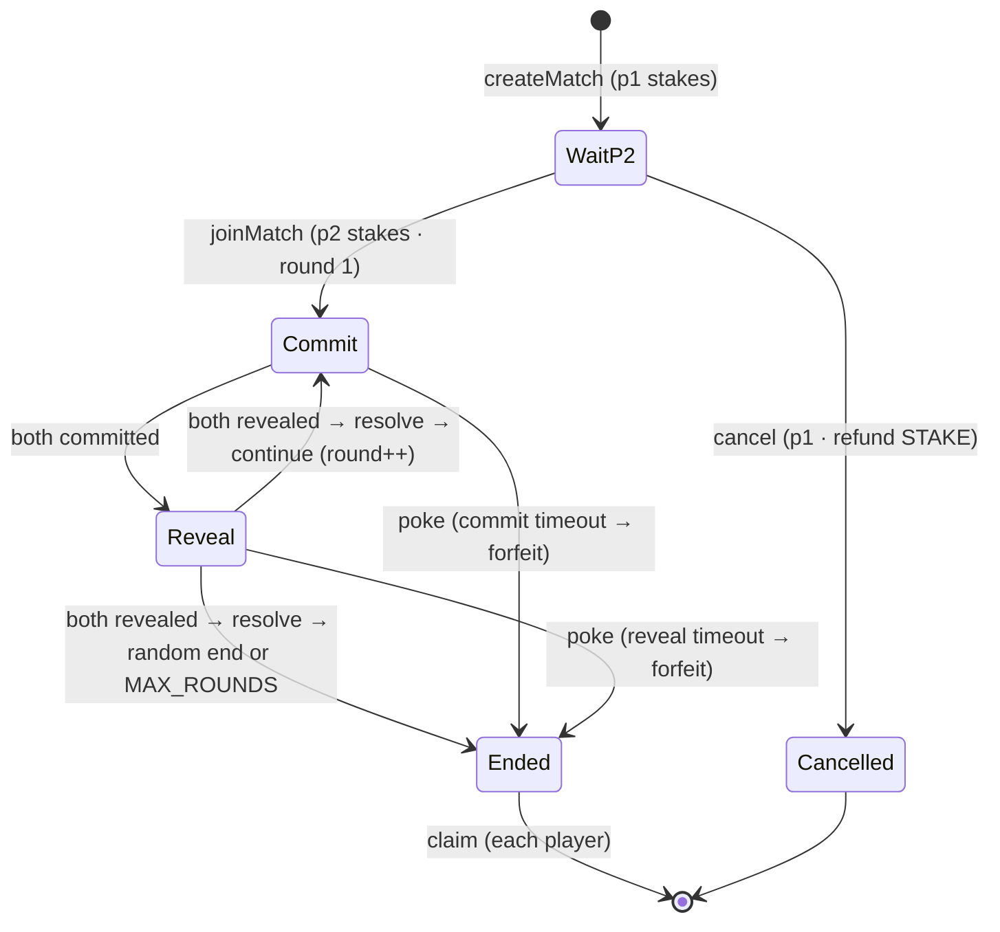
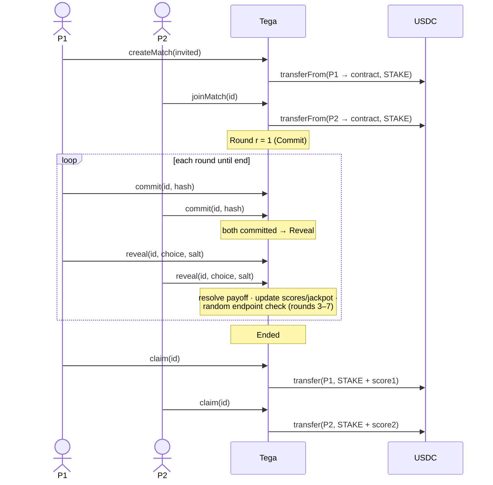

# TEGA — contracts

**`Tega.sol`** is the on-chain engine for TEGA, a 2-player **split-or-steal trust game** on Monad. Two players each escrow a fixed stake of ERC-20 USDC, then play several rounds of **commit–reveal**: each round they secretly choose **BAGI** (share) or **EMBAT** (steal), lock it, and open simultaneously. An escalating "ante" shifts between them per a payoff matrix. The game ends at a hidden random point (or at round 8); each player then withdraws `STAKE + score`.

- **Solidity** `^0.8.24` · **Foundry** · **OpenZeppelin v5** (`SafeERC20`, `ReentrancyGuard`, `AccessControl`)
- **Monad** testnet (chainId `10143`) / mainnet (`143`). Stake = ERC-20 USDC (6 decimals); `MON` is only for gas.
- **No backend** — the chain is the matchmaker (clients watch events) and the settlement layer.

## Game flow

1. **`createMatch(invited)`** — p1 escrows `STAKE`. `invited == 0` → open table (anyone with the id can join); otherwise locked to `invited` (a direct challenge; clients watch `MatchCreated(..., invited == me)` as an inbox).
2. **`joinMatch(id)`** — p2 escrows `STAKE`; round 1 begins (Commit phase).
3. Each round: both **`commit(id, hash)`** (hidden choice) → both **`reveal(id, choice, salt)`** → the contract resolves the payoff and decides whether to continue.
4. **End** — on a random endpoint (rounds 3–7) or at `MAX_ROUNDS` (8).
5. **`claim(id)`** — each player withdraws `STAKE + score` (always ≥ 0).

A stalled match is resolved by anyone via **`poke(id)`** after the deadline (the no-show forfeits). An unjoined match can be **`cancel`**-led by p1 for a full refund.

### State machine



### Happy-path sequence



## Payoff matrix (ante `A` for the round)

|            | p2 **BAGI** | p2 **EMBAT**                 |
| ---------- | ----------- | ---------------------------- |
| p1 **BAGI**  | `0 / 0`     | `−A / +A`                    |
| p1 **EMBAT** | `+A / −A`   | `−A / −A` → `jackpot += 2A`  |

`score` accumulates per round; **ante grows each round**: `ante(r) = STAKE * r / 36`. Reputation: every BAGI → `coops++`, every EMBAT → `betrays++` (`trustScore = coops·100/total`).

**Conservation invariant (always holds):** `payout1 + payout2 + jackpot == 2·STAKE` per match, and `payout = STAKE + score ∈ [0, 2·STAKE]`.

## Core functions

| Function | Who | What |
| --- | --- | --- |
| `createMatch(address invited) → id` | p1 | Open or challenge a match; escrow STAKE. |
| `joinMatch(uint256 id)` | p2 | Join + escrow STAKE; start round 1. |
| `cancel(uint256 id)` | p1 | Refund STAKE if no one joined (→ `Cancelled`). |
| `commit(uint256 id, bytes32 hash)` | player | Lock a hidden choice. `hash = keccak256(choice, salt, id, round, msg.sender)`. |
| `reveal(uint256 id, Choice choice, bytes32 salt)` | player | Open the choice; resolves the round when both reveal. |
| `poke(uint256 id)` | anyone | Resolve a timed-out round (no-show forfeits). |
| `claim(uint256 id)` | player | Withdraw `STAKE + score` once `Ended`. |
| `trustScore(address) → uint256` | view | Reputation 0–100 (defaults to 100). |
| `distributeJackpot(address to, uint256 amount)` | `TREASURER_ROLE` | Pay out from the jackpot prize pool (bounded to it; never touches match escrow). Winner selection is off-chain. |

Internal: `_resolveRound` (payoff + reputation), `_advance` (random endpoint / next round / end), `_penalize` (forfeit resolution), `_pullStake` (exact-amount escrow), `ante`, `_key`.

**Events:** `MatchCreated` (indexed `invited`), `PlayerJoined`, `RoundStarted`, `Committed`, `Revealed`, `RoundResolved`, `GameEnded`, `Claimed`, `MatchCancelled`, `JackpotDistributed`.

**Constants:** `MAX_ROUNDS=8`, `MIN_ROUNDS=3`, `END_PROB=25` (%), `COMMIT_WIN=15s`, `REVEAL_WIN=10s`, `STAKE=5_000_000` (5 USDC).

## Design & safety highlights

- **Grind-resistant random endpoint** — seeded from the revealed salts `keccak256(salt1, salt2, id, round)` (locked at commit, combined at reveal), so no player can time/grind the game's end. Purpose: hide which round is last, breaking backward-induction. (`block.prevrandao` is deliberately NOT used.)
- **Fair forfeits** — on timeout the honest player takes the *remaining* escrow (`2·STAKE − jackpot-so-far`), never a fresh `2·STAKE`, so the contract stays solvent even after a mutual-steal round.
- **Escrow is trustless** — `SafeERC20` + exact-amount receive check + pull-payment `claim` with checks-effects-interactions + `nonReentrant`. The only privileged function (`distributeJackpot`) is bounded to the jackpot pool and can never touch active-match escrow.
- Constructor: `constructor(IERC20 token, address admin)` — `admin` holds `DEFAULT_ADMIN_ROLE` + `TREASURER_ROLE` (intended: a multisig).

## Usage

```shell
forge build            # compile
forge test             # run tests
forge fmt              # format
```

### Deploy

`script/Deploy.s.sol` deploys **only `Tega`** (the USDC stake token already exists on-chain). It defaults the stake token to devnads test USDC and the admin/treasurer to the deployer.

```shell
cp .env.example .env     # set MONAD_RPC_URL + a BURNER PRIVATE_KEY (testnet only)
make deploy-testnet      # broadcast to Monad testnet (10143) + attempt Sourcify verification
```

`make deploy-testnet` expands to:

```shell
forge script script/Deploy.s.sol:Deploy --rpc-url $MONAD_RPC_URL --broadcast \
  --verify --verifier sourcify --verifier-url https://sourcify-api-monad.blockvision.org
```

Encrypted-keystore alternative (key never hits disk in plaintext):

```shell
cast wallet import tega-burner --interactive
forge script script/Deploy.s.sol:Deploy --rpc-url monad --account tega-burner --broadcast
```

**Env overrides** (optional): `USDC_ADDRESS` (e.g. mainnet USDC for a mainnet deploy) · `ADMIN_ADDRESS` (e.g. a treasurer multisig). Fund the deployer with testnet **MON** for gas first (`cast wallet address --private-key $PRIVATE_KEY`, then the [faucet](https://faucet.monad.xyz)).

After deploy, paste the printed address into `web/.env.local` (`NEXT_PUBLIC_CONTRACT_ADDRESS`) and run `make abi` to refresh `web/lib/tega/abi.ts`. See the root [README deploy section](../README.md#deploy-to-monad-testnet).

### Stake token (USDC) — passed to the constructor per network

| Network | USDC address | Explorer |
| --- | --- | --- |
| Monad **testnet** (10143) | `0x56bf9CDc3C1876F3F22655a0016C2743E9e39a73` (devnads test USDC) | [testnet.monadvision.com](https://testnet.monadvision.com/token/0x56bf9CDc3C1876F3F22655a0016C2743E9e39a73) |
| Monad **mainnet** (143) | `0x754704Bc059F8C67012fEd69BC8A327a5aafb603` | [monadvision.com](https://monadvision.com/token/0x754704Bc059F8C67012fEd69BC8A327a5aafb603) |

Both verified on-chain: symbol `USDC`, **6 decimals** (so `STAKE = 5_000_000` = 5 USDC). `cast code`-verify before any deploy. On testnet, players claim devnads test USDC at [devnads.com/tokens](https://devnads.com/tokens) and approve it themselves; the contract never mints.
